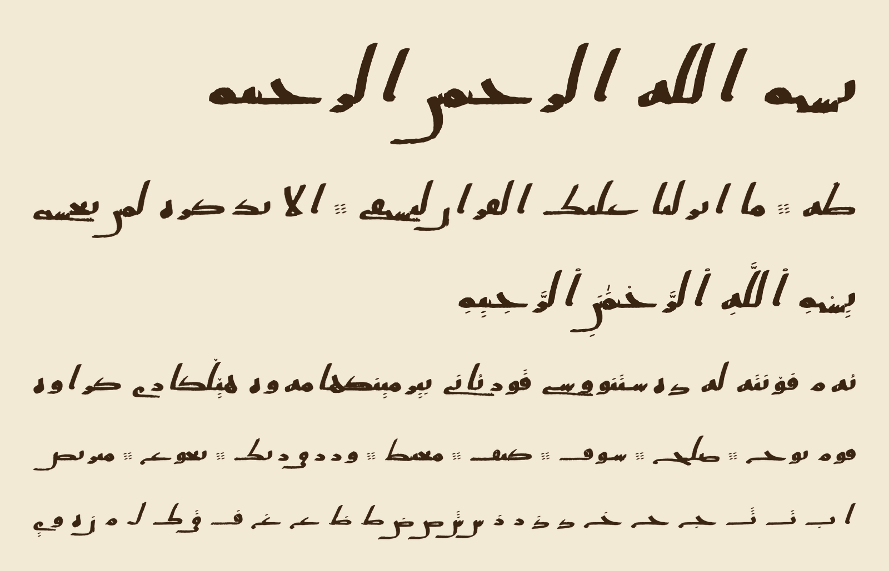
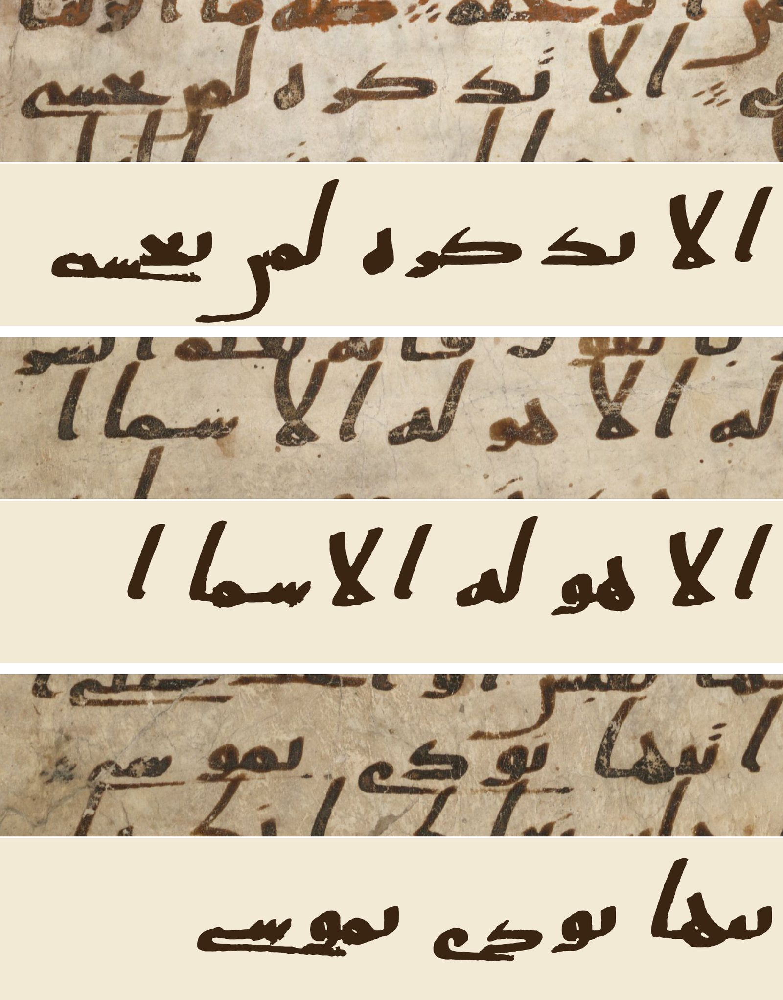
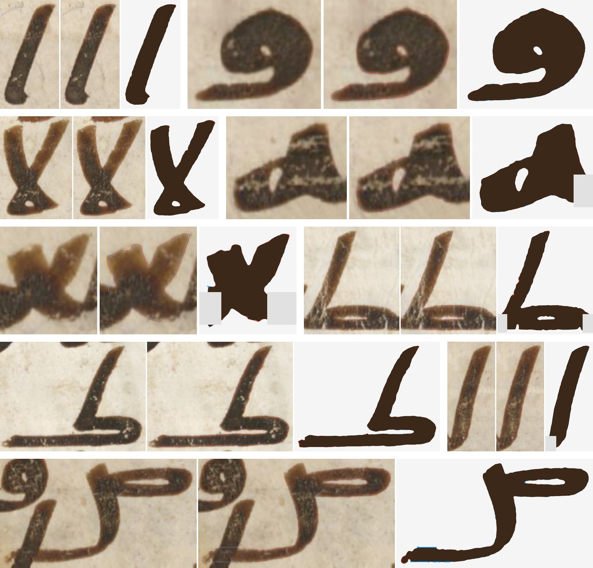
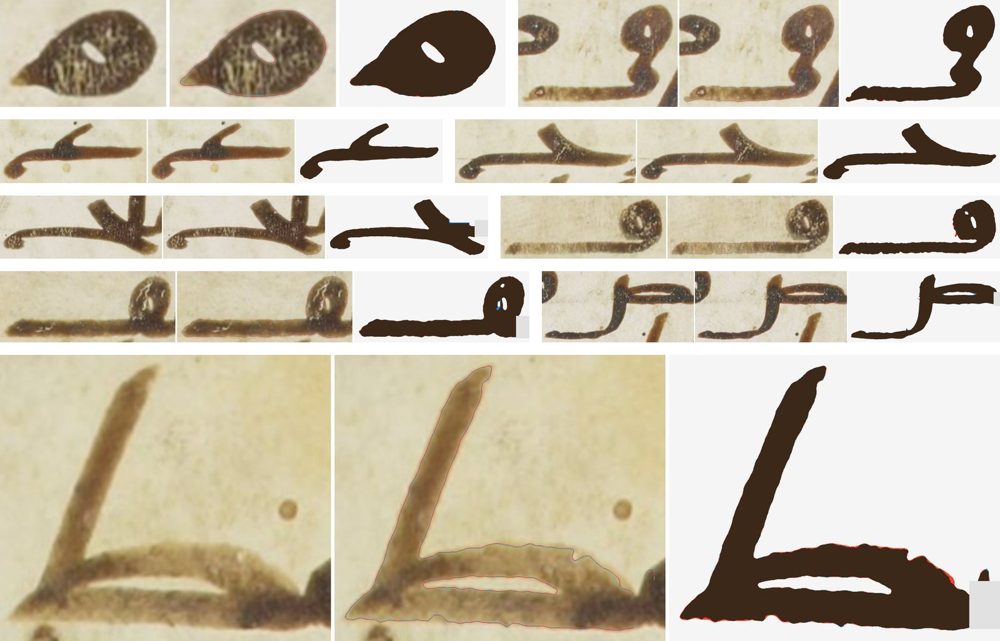
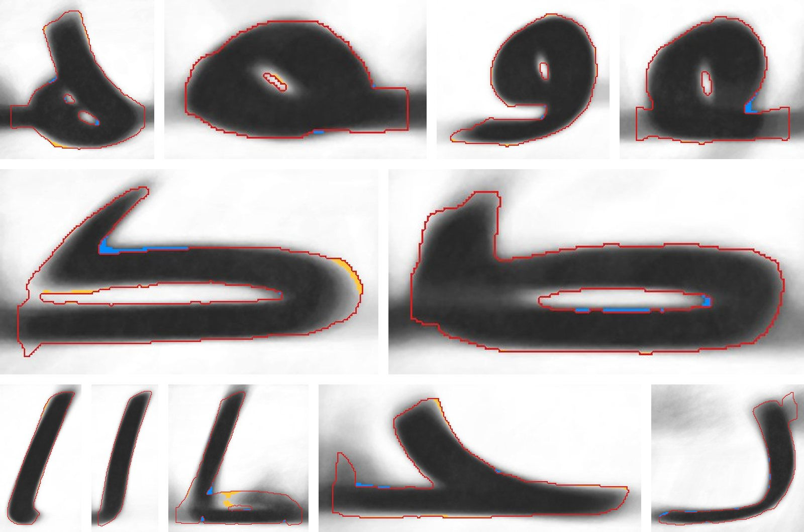
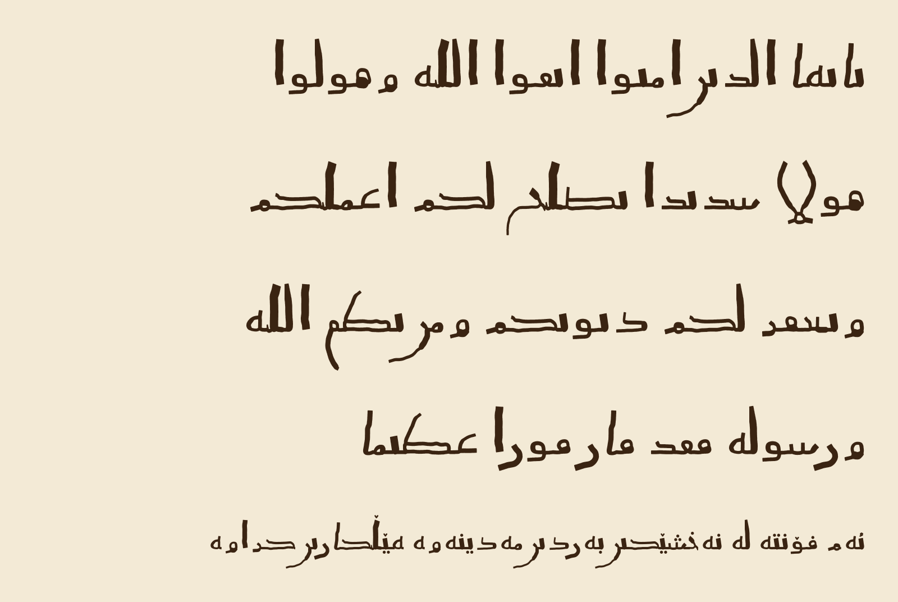

# Early Qur'an Fonts

Fonts whose letters are traced from the earliest written Qur'an: the shapes are
taken from photographs of the original ink and carving, not redrawn.

فۆنتگەلێک کە پیتەکانیان لە کۆنترین دەقە نووسراوەکانی قورئانەوە هێڵکاری کراون:
شێوەی پیتەکان لە وێنەی مەرەکەب و هەڵکۆڵینە ڕەسەنەکانەوە وەرگیراون، نەک بە دەست کێشراون.

*Birmingham Hijazi. The first two lines are set without dots (`ss01`), as the
manuscript is written; then the basmala with vowel marks, a line of Kurdish,
the words that the nine forms from the Paris leaves were taken from, and the
alphabet.*

## Fonts

| Font | Source | Status |
|---|---|---|
| [Birmingham Hijazi](Birmingham%20Hijazi%20%28new%20-%20from%20the%20Birmingham%20manuscript%29) | The Birmingham Qur'an manuscript (Cadbury Research Library, Mingana Islamic Arabic 1572a), parchment dated 568–645 CE, and the leaves of the same Qur'an in Paris (BnF Arabe 328, folios 71–86) | Version 4.100 — all 62 letter forms and the dots traced from the manuscript, checked against it pixel by pixel and against all 34 pages of the same Qur'an ([README](Birmingham%20Hijazi%20%28new%20-%20from%20the%20Birmingham%20manuscript%29/README.txt)) |
| [Madinah Naqsh](Madinah%20Naqsh%20%28draft%20-%20from%20the%20Ahzab%2070-71%20inscription%29) | A rock inscription near Medina carrying Qur'an 33:70–71 | Draft 0.200 — 28 letter forms: the centre line and the width of every stroke, taken from a small photograph ([README](Madinah%20Naqsh%20%28draft%20-%20from%20the%20Ahzab%2070-71%20inscription%29/README.txt)) |

Both fonts write Arabic and Kurdish (Sorani), have Arabic joining, lam-alef,
vowel marks, and two stylistic sets: `ss01` (rasm only, without dots) and
`ss02` (hide vowel marks).

Each font folder holds the `.ttf`, its README and a `source/` folder with the
scripts that trace the letters, build the font and measure it against the
original. The README of each font explains how to rebuild it.

## Birmingham Hijazi, compared with the manuscript

*Three lines of the Birmingham manuscript (folio 2r, lines 11, 16 and 20:
Ta-Ha 3, 8 and 11). Under each one is the same text, in the scribe's spelling,
set in the font at the same size.*

*The pixel audit, shown for nine of the 62 traced letter forms. By row, left
to right: alif ا and waw و; lam-alif لا and final ha ـه; medial ain ـعـ and
medial ta ـطـ; kaf ک and initial lam لـ; sad ص. Each set of three shows the letter in the manuscript; the same
picture with the edge of the ink in light blue and the edge of the font in
red; and the difference (blue: ink the font lacks, red: font where there is
no ink, grey: the joins, which are left out). Over all 62 forms the font's edge
is on average 0.15 px of the photograph from the ink's edge.*

*The nine forms that do not occur on the two large Birmingham pages, traced
from the leaves of the same Qur'an in Paris (BnF Arabe 328, folios 71–86;
photographs: gallica.bnf.fr / Bibliothèque nationale de France). By row, left
to right: isolated mim م (قوم) and isolated qaf ق (ورزق); isolated ain ع (تجوع)
and isolated ha ح (ينوح); final ha ـح (صلح) and isolated fa ف (سوف); final fa ـف
(كيف) and final sad ـص (متربص); final ta ـط (محيط).*

What was measured, in pixels of the Birmingham photograph (one pixel is about
0.085 mm of parchment):

| Check | Result |
|---|---|
| The font against the letter it was traced from (62 forms) | 0.15 px on average; 95 % of the outline within 0.41 px |
| Two instances of the same letter in the scribe's own hand (390 instances traced) | 2.00 px apart |
| The letter the font uses against the scribe's other instances of it | 1.85 px |
| A letter on the Paris leaves against the same letter in Birmingham (26 letters) | 1.85 px |
| The dots: 319 dashes of the manuscript measured | length 24.0 px, thickness 7.6 px, slant 22.5°; the font's dot is one of them, traced |

The scribe did not write every page at the same size: on three of the Paris
pages the letters are smaller and the pen finer (0.83–0.89 of the Birmingham
writing), and those pages are enlarged by that much before a letter is taken
from them.

Version 4.1 adds a check over the whole Qur'an. Every form of the font is laid
over each of the 34 pages (2 in Birmingham, 32 in Paris), and the places where
it fits are taken as instances of that letter.

*The scribe's "middle letter" of eleven forms: the grey shows how many of the
instances found on the 34 pages have ink at each point (black: all of them),
the red line is the outline of the font's letter. Blue marks ink that most
instances have and the font lacks, orange ink of the font that few instances
have. First row: medial ha', final
mim, isolated waw, medial fa'. Second row: initial kaf, initial sad. Third row:
isolated alif, initial lam, medial ta', initial ha', final nun.*

| Check over all 34 pages | Result |
|---|---|
| Places looked at; instances accepted | 14,664; 10,049, of 59 forms |
| An instance of the scribe against the middle letter of its form | 2.21 px |
| The letter of the font against the middle letter | 1.47 px |
| Forms in which the font's letter is nearer to the middle than most instances | 55 of 59 |
| Size of the writing | folios 71–77: 0.76–0.89 of Birmingham; folios 78–86: 0.87–0.98 |
| Dots measured | 4,344 dashes; same length everywhere, slant 19.5° to 26° by gathering |

This check found two faults inside letters that the comparison of outlines
could not see. In medial ha' the ink of the exemplar had flaked and a flaked
patch had been taken for the eye of the letter; in final mim the eye, a slit
about 3 px wide, had been closed as if it were a crack. Both are corrected.
An instance is found because it looks like the font's letter, so the scribe's
true variation is larger than these figures. The
[README of the font](Birmingham%20Hijazi%20%28new%20-%20from%20the%20Birmingham%20manuscript%29/README.txt)
describes each check and what in the font is not from the manuscript.

## Madinah Naqsh

*Madinah Naqsh: the text of the inscription (al-Ahzab 70–71), without dots as
it is carved, and a line of Kurdish. The photograph the letters were traced
from is not shown here, because it belongs to its photographer.*

The photograph is small: an alif is 40 to 70 pixels tall in it, and the edge
of a letter is mostly blur. Draft 0.2 therefore does not trace edges. For
every stroke it takes the centre line and the width from the photograph and
draws the stroke again with a clean edge.

| Measured on the photograph | Result |
|---|---|
| Width of a level stroke on the three lines | 5.8, 4.2 and 3.6 px: one width once the lines are brought to one size |
| Width of an upright stroke | 8.4, 7.4 and 8.4 px: one and a half times to twice a level stroke |
| Blur of the photograph | 2.8 px |
| Centre line of the font to the brightest line of the carving | 0.36 px on average, 95 % within 0.92 px |

The photograph looks along the rock, so the upper lines are foreshortened;
their letters are narrowed by 0.84 and 0.77. Those two figures come from a
rule, not a measurement, and the lowest line is itself seen at a slant by an
unknown amount. The font's
[README](Madinah%20Naqsh%20%28draft%20-%20from%20the%20Ahzab%2070-71%20inscription%29/README.txt)
says what is not certain and what was decided by hand.

The figures are drawn by
[`make_readme_figures.py`](Birmingham%20Hijazi%20%28new%20-%20from%20the%20Birmingham%20manuscript%29/source/make_readme_figures.py)
from the fonts and photographs of the manuscript.

## Other fonts in this repository

For comparison, the repository also contains fonts by other authors, unchanged
and under their own licenses: [Raqq, Qahiri and Qashib](Kufic%20%28later%20style%20-%20not%20Birmingham%29) (Aliftype) and
[hijazi](Hijazi%20-%20general%20%28Khalid%20Alabdullah%2C%202019%29) (Khalid Alabdullah). See
[THIRD_PARTY_NOTICES.md](THIRD_PARTY_NOTICES.md).

## Not in this repository

The photographs of the Medina inscriptions belong to their photographer,
Muhammad al-Maghdhawi ([@mohammed93athar](https://x.com/mohammed93athar)), and
are not published here. The same goes for the preview page that embeds them.

The photographs of the Paris leaves (93 MB) are not kept here either; the
script `fetch_bnf.py` in the source folder of Birmingham Hijazi downloads them
from the Bibliothèque nationale de France.

## License

This project is licensed under the **Aland Attribution & Non-Commercial License
(AANCL) v1.0**. Copyright (c) 2026 Aland Kawa Ali. The full terms are in the
[LICENSE](LICENSE) file.

You may view, study, copy, modify and share the fonts and their source for
personal and other non-commercial purposes. Attribution is mandatory: credit
Aland Kawa Ali as the original author, keep the copyright notice and the
license intact, and mark any changes you make. Commercial use — including
selling the fonts, or using them in commercial products or paid services —
requires prior written permission from the copyright holder.

AANCL is a custom license. It is not an OSI-approved open-source license.
Third-party fonts and photographs of the manuscripts in this repository keep
their own licenses or status; see [THIRD_PARTY_NOTICES.md](THIRD_PARTY_NOTICES.md).

**مۆڵەت:** ئەم پڕۆژەیە لە ژێر مۆڵەتی Aland Attribution & Non-Commercial License
(AANCL) v1.0 دایە، مافی لەبەرگرتنەوە © 2026 بۆ Aland Kawa Ali. بەکارهێنانی
ناتیجاری ڕێگەپێدراوە بە مەرجی ناوهێنانی خاوەنەکەی؛ بەکارهێنانی تیجاری
ڕەزامەندیی نووسراوی پێشوەختەی خاوەنەکەی دەوێت. بڕوانە [LICENSE](LICENSE).
